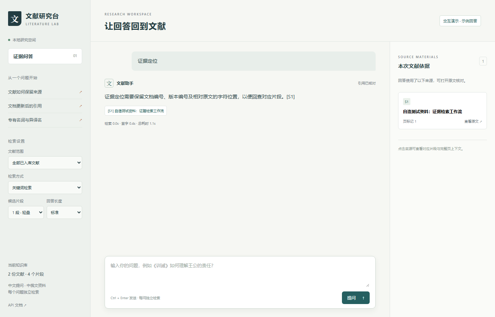
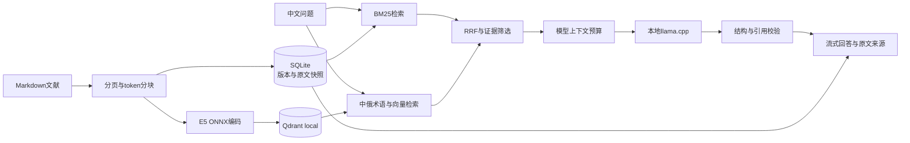

<div align="center">

# Literature Evidence RAG

### 中俄文文献检索与证据问答

用中文查找文献，让回答可以回到原文。

[](https://github.com/eliaukyh17-droid/literature-evidence-rag/actions/workflows/ci.yml)


[](LICENSE)

[快速体验](#快速体验) · [接入真实模型](docs/RUNNING.md) · [架构与取舍](docs/ARCHITECTURE.md) · [评测记录](docs/EVALUATION.md)

</div>



*界面使用仓库自造的测试文档，右上角明确标记示例回答。真实模型验证另见评测记录。*

## 为什么做这个项目

大量资料是俄文，使用者习惯中文提问。同一个人名可能有多种译法，单纯关键词难以匹配，向量召回也会漏掉专有名词。模型即使能回答，仍需要确认依据来自哪份文献、哪一段，以及文档更新后引用是否有效。

本项目把这些问题拆成可核对的步骤，提供多语检索、带版本的证据、流式回答和原文查看。默认在本机运行，应用端使用回环地址连接模型。

## 已实现

| 能力 | 工程实现 |
| --- | --- |
| 多语检索 | SQLite FTS5/BM25、multilingual-e5-small ONNX、Qdrant exact cosine、RRF、显式中俄术语子查询 |
| 文献接入 | 分页解析、重叠分块、精确token预算、原始Unicode位置、内容哈希与版本指纹 |
| 索引维护 | 幂等导入、事务更新、逻辑删除、旧证据410、过期索引503、向量缓存与续建 |
| 证据问答 | 实际模型模板与分词计数、上下文裁剪、JSON Schema约束、引用ID校验、资料不足状态 |
| 流式服务 | FastAPI + SSE、阶段事件、正文增量、请求ID/序号、有限队列、超时、取消与上游连接清理 |
| 浏览器体验 | 文献范围、检索方式、连续独立提问、停止生成、来源卡片和原文高亮 |

## 快速体验

需要Python 3.11–3.13和[uv](https://docs.astral.sh/uv/getting-started/installation/)。下面使用确定性的示例生成器，可以直接检查交互、检索、引用和取消流程。

```bash
git clone https://github.com/eliaukyh17-droid/literature-evidence-rag.git
cd literature-evidence-rag
uv sync --locked --extra vector
uv run --locked python scripts/run_demo.py
```

打开 **http://127.0.0.1:8000/**，点击侧边栏示例，或提问“文献导入后怎样保留证据定位？”。每个问题独立检索，当前页面保留问答记录。

接入自己的资料与本地模型后，同一套接口会执行真实RAG流程。完整命令包含模型别名、E5下载、向量建库和Windows/Unix配置。[真实模型运行说明](docs/RUNNING.md)

## 架构



浏览器先展示检索与资料读取阶段，随后显示待校验文字。只有最终结构和引用集合通过校验后才确认完成，错误时清除本次预览。停止操作会传递到生成任务和模型HTTP连接。

## 实测快照

在10份私有研究文献、974个页标记的试点中，2770个片段的原文位置全部往返核验，E5输入最长512 token、截断0。调整分块时复用1836个已核验完整向量，新编码934片段。

| 同一开发题集，26道有证据问题 | Success@10 |
| --- | --- |
| BM25 | 9 / 26 |
| E5向量 | 10 / 26 |
| 中俄术语 + RRF | 21 / 26 |

术语层经过开发题反馈调整，这些结果用于说明迭代过程。独立测试集与答案证据支持率仍待补充。原文、私有题目和模型权重由使用者自行管理，公开仓库提供代码、自造样例和聚合统计。[评测口径与已知限制](docs/EVALUATION.md)

## 测试与运行

```bash
uv run --locked --extra vector pytest -q
uv run --locked ruff check src tests scripts
uv run --locked ruff format --check src tests scripts
node --test tests/web_client.test.mjs
```

本地基线已通过74项Python测试、3项浏览器数据处理测试及7项真实Edge操作检查。真实Q5模型验证了事实回答、资料不足、中文查俄文和中途取消。原生浏览器检查脚本适用于安装Edge的Windows环境，Node测试使用Node 22或以上。

| 路径 | 用途 |
| --- | --- |
| `src/literature_kb/` | 导入、检索、版本、生成与流式API |
| `src/literature_kb/web/` | 同源浏览器研究台 |
| `examples/` | 自造公开样例 |
| `scripts/run_demo.py` | 无模型下载的交互体验 |
| `scripts/download_embedding.py` | 固定版本、核对哈希的E5下载 |
| `tests/` | 单元、接口、流式与前端数据处理测试 |
| `docs/` | 运行、架构、协议与评测说明 |

## 适用范围

当前按本机单用户、单API worker设计，Qdrant local独占目录。问答记录保留于页面内存。持久化导入任务、会话存储、独立答案评测和服务化并发验证列为后续工作。CPU 8B模型的首字等待较长，具体硬件与实测耗时见评测说明。

## 许可

代码与自造样例采用[MIT许可](LICENSE)。第三方模型、运行程序和使用者提供的文献分别遵循各自许可。
